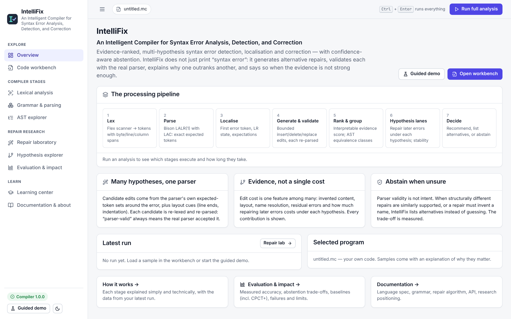
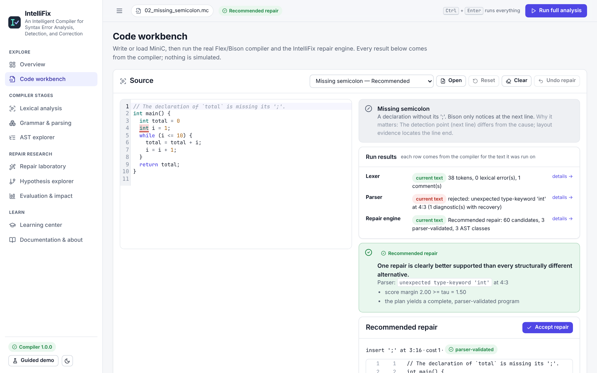
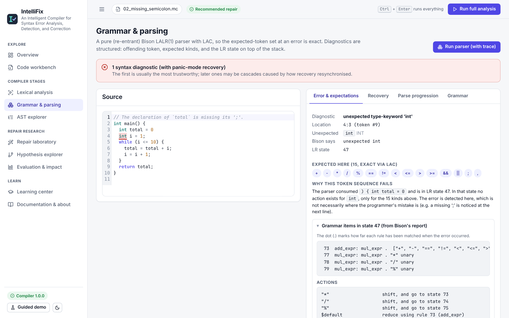
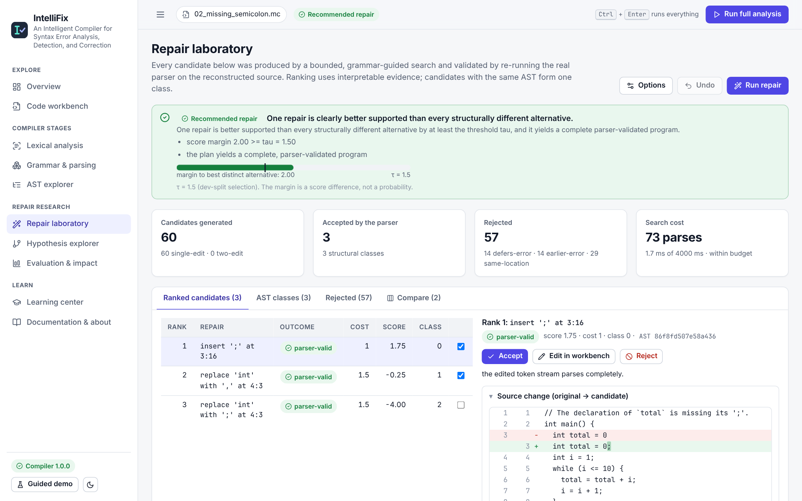
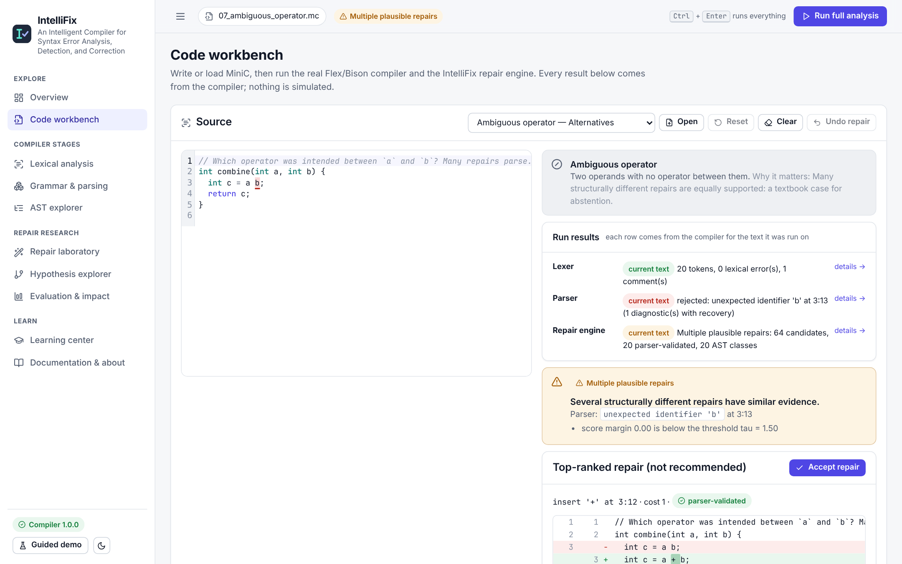
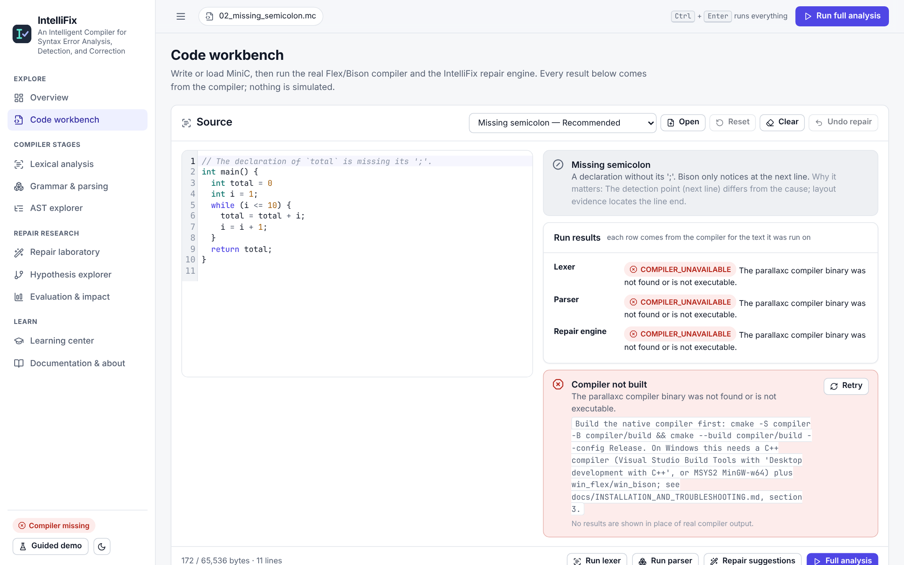

# IntelliFix — visual walkthrough

Every image is a screenshot of the running application, taken on 25 Oct 2026. The backend was running the real `parallaxc` compiler at τ = 1.5. The script that takes them is in §6 and can be re-run. Images are in `docs/images/walkthrough/` at 2160 × 1350.

## 1. Overview



- The header gives the full project title.
- **The processing pipeline** names the seven stages (Lex → Parse → Localise → Generate & validate → Rank & group → Hypothesis lanes → Decide). After a run, each stage shows whether it ran and how long it took.
- The bottom left shows **Compiler 1.0.0**: the backend found the compiler binary. If it says **Compiler missing**, see §5.

## 2. The workbench, one button at a time

Sample *Missing semicolon* (`int total = 0` without `;` on line 3).

| Step | Screenshot | What to point at |
|---|---|---|
| Sample loaded | [02](images/walkthrough/02-workbench-loaded.png) | the explanation card (“Bison only notices at the next line”); every run row says *not run yet* |
| **Run lexer** | [03](images/walkthrough/03-workbench-after-lexer.png) | Lexer row: “38 tokens, 0 lexical error(s), 1 comment(s)”. No error: spelling is fine |
| **Run parser** | [04](images/walkthrough/04-workbench-after-parser.png) | Parser row: “rejected: unexpected type-keyword 'int' at 4:3”; `int` is underlined on **line 4** |
| **Full analysis** | [05](images/walkthrough/05-workbench-full-analysis.png) | Repair row “Recommended repair: 60 candidates, 3 parser-validated, 3 AST classes”; green panel with “score margin 2.00 >= tau = 1.50”; the diff adds `;` at the end of **line 3**; **Accept repair** |



Each row has a **current text** badge. If you type after running, it changes to **earlier text**, so no one mistakes an old result for the current code.

## 3. One page per compiler stage

| Page | Screenshot | What it shows (real data from the same run) |
|---|---|---|
| Lexical analysis | [06](images/walkthrough/06-lexical-analysis.png) | token table: kind, category, lexeme, start, end, byte offsets; click a token to highlight its source |
| Grammar & parsing | [07](images/walkthrough/07-grammar-and-parsing.png) | the diagnostic, the 15 tokens LAC says were expected, **LR state 47** with its items and actions from Bison's own report, and a plain-language reason |
| AST explorer (invalid source) | [08](images/walkthrough/08-ast-explorer.png) | “No valid AST for this source”: no tree is invented for an invalid program |
| AST explorer (valid program) | [08b](images/walkthrough/08b-ast-explorer-valid.png) | 32 nodes, depth 8, the canonical hash, and the tree with source positions |



## 4. Repair research pages

| Page | Screenshot | What to point at |
|---|---|---|
| Repair laboratory | [09](images/walkthrough/09-repair-laboratory.png) | decision panel with the margin bar against τ; counts (60 generated, 3 accepted, 57 rejected, 73 parses); ranked candidates 1.75 / −0.25 / −4.00 |
| Evidence breakdown | [09b](images/walkthrough/09b-repair-laboratory-evidence.png) | the reconstructed diff, “re-lexing it reproduces the edited stream exactly (verified)”, and one bar per evidence feature: −1.00 cost, +2.00 resolves, +0.75 line-end `;` |
| Hypothesis explorer | [10](images/walkthrough/10-hypothesis-explorer.png) | three lanes, one per structurally different first fix; each ends in a valid program; the best one is marked |
| Evaluation & impact | [11](images/walkthrough/11-evaluation.png), [11b](images/walkthrough/11b-evaluation-charts.png) | provenance (900 cases, synthetic, τ chosen on dev); 71.5% / 6.1% / 50.7% / 86.7%; *improved*, *caveat* and *note* labels; accuracy and risk–coverage charts |



## 5. One screenshot per decision

| Status | Sample | Screenshot | What it shows |
|---|---|---|---|
| No repair needed | Valid program | [16](images/walkthrough/16-valid-program.png) | “accepted: valid program, AST with 32 nodes”; only lex, parse and localise ran |
| Recommended | Missing semicolon; Two errors | [05](images/walkthrough/05-workbench-full-analysis.png), [15](images/walkthrough/15-two-errors.png) | the two-error plan fixes a missing `;` and a missing `)` in one step each (margin 3.50) |
| Multiple plausible | Ambiguous operator (`a b`) | [12](images/walkthrough/12-multiple-plausible.png) | “score margin 0.00 is below the threshold tau = 1.50”; the top fix is labelled *not recommended* |
| Low confidence | Missing variable name (`int = 42;`) | [13](images/walkthrough/13-low-confidence.png) | “1 placeholder token(s) in the best plan”; the fix inserts `__hole` |
| Unsupported construct | Unsupported C construct (`i++`) | [14](images/walkthrough/14-unsupported-construct.png) | “increment/decrement operator '++' is not part of MiniC; write x = x + 1” |
| Compiler not built | any (backend with the binary missing) | [18](images/walkthrough/18-compiler-not-built.png) | every run row shows `COMPILER_UNAVAILABLE`; the banner gives the exact build command; badge **Compiler missing**; no fake results |





Screenshot 18 is the state the team saw on Windows before MSVC or MinGW was set up. It was produced with the same UI and a second backend whose `PARALLAX_COMPILER` points to a file that does not exist.

## 6. Re-take the screenshots

1. Start the backend on :8000.
2. Optionally start a second one with `PARALLAX_COMPILER=/nonexistent` on :8001.
3. Run the Playwright script (it uses sidebar navigation so results stay in memory):

```bash
node deliverables/build/take_screenshots.cjs   # each page at 1440×900, scale 1.5, light theme
```

The script loads samples through the `#sample` select and presses the real buttons.
